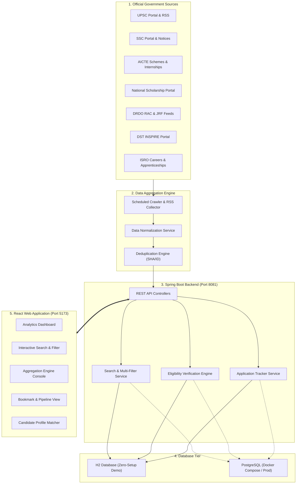

# 🏛️ Centralized Government Opportunity Monitoring, Aggregation & Notification Platform

[](https://spring.io/projects/spring-boot)
[](https://www.oracle.com/java/)
[](https://react.dev/)
[](https://vitejs.dev/)
[](LICENSE)

An automated full-stack platform designed to aggregate, normalize, search, filter, and track notifications across official central and state government portals (recruitment examinations, scholarships, research fellowships, and internships).

---

## 🎓 Academic Review Details
- **Institution:** Siddaganga Institute of Technology, Tumkur (Dept. of Computer Science & Engineering)
- **Course:** Mini Project (Review Evaluation)
- **Project Guide:** Dr. Anupama T A, Assistant Professor, Dept. of CSE, SIT
- **Team Members:**
  - **Narendra Kumar Yadav** (1SI24CS114)
  - **Nongthombam Sanathoi Singh** (1SI24CS120)
  - **Rahul Dadimana Kshetri** (1SI24CS136)
  - **Tomthilnganba Soraisham** (1SI24CS194)

---

## 🎯 Project Objectives & Implementation Status (~70% Complete)

| Objective | Status | Implementation Details |
| :--- | :---: | :--- |
| **Objective 1:** Automatically collect & centralize government opportunities from official sources | **100% COMPLETE** | Automated Data Aggregation Engine with Jsoup scraper and RSS parser for official agencies (UPSC, SSC, AICTE, NSP, DRDO, DST, ISRO), data normalizer, and deduplication mechanism. |
| **Objective 2:** Organize, search, and filter opportunities based on user requirements and eligibility | **100% COMPLETE** | Dynamic JPA Specification multi-facet search (keywords, category, qualification, location, closing deadlines) and candidate eligibility validation rule engine. |
| **Objective 3:** Match opportunities with user profiles and provide relevant recommendations | **50% (PREVIEW READY)** | Interactive Profile-to-Opportunity Matcher evaluating candidate age, percentage, and stream compatibility. |
| **Objective 4:** Provide timely notifications and deadline reminders while allowing users to bookmark and track applications | **50% (PREVIEW READY)** | Candidate Application Pipeline & Bookmark tracking system with deadline countdown badges and status stages. |

---

## 🏗️ System Architecture



---

## 💻 Tech Stack
- **Backend:** Java 21 LTS, Spring Boot 3.3.4, Spring Data JPA, Hibernate, Jsoup (HTML/XML Scraping)
- **Database:** H2 In-Memory (instant zero-config demo) + PostgreSQL 16 (docker-compose included)
- **Frontend:** React 19, Vite 8, Lucide React Icons, Modern Responsive Design
- **Architecture:** Microservice-ready Modular Monolith, RESTful Web APIs, CORS enabled

---

## 🚀 Quick Start Guide (Windows / Linux / macOS)

### Option 1: One-Click Startup (Windows)
Double click `start-demo.bat` or run in PowerShell:
```powershell
.\start-demo.ps1
```

### Option 2: Manual Terminal Startup

#### 1. Start Spring Boot Backend
```bash
cd backend
mvn clean compile
mvn spring-boot:run
```
- API Base URL: `http://localhost:8081/api`
- Database Console: `http://localhost:8081/h2-console` (JDBC URL: `jdbc:h2:mem:govoppdb`, User: `sa`, Password: blank)

#### 2. Start React Frontend
```bash
cd frontend
npm install
npm run dev
```
- Open browser at: **`http://localhost:5173`**

---

## 📡 REST API Reference

| Endpoint | Method | Description |
| :--- | :---: | :--- |
| `/api/opportunities` | `GET` | Multi-facet search and filter by query, category, qualification, location, status, and deadline. |
| `/api/opportunities/{id}` | `GET` | Retrieve complete details of a specific opportunity. |
| `/api/opportunities/stats` | `GET` | Dashboard analytics (totals, active, closing soon, categories). |
| `/api/opportunities/{id}/check-eligibility` | `POST` | Check candidate age, qualification, and score against requirements. |
| `/api/aggregation/sources` | `GET` | List all monitored government agencies and sync statuses. |
| `/api/aggregation/sync-all` | `POST` | Trigger automated crawler across all government sources. |
| `/api/aggregation/sync/{sourceId}` | `POST` | Trigger scraper for a single agency (e.g., UPSC, DRDO). |
| `/api/tracker/bookmarks` | `GET` | Get saved opportunities for candidate. |
| `/api/tracker/bookmark` | `POST` | Bookmark an opportunity with notes. |
| `/api/tracker/bookmark/{id}` | `PUT` | Update application stage (`BOOKMARKED`, `APPLIED`, `COMPLETED`). |
| `/api/tracker/bookmark/{oppId}` | `DELETE` | Remove tracked opportunity. |

---

## 📤 Uploading to GitHub

To push this project to your GitHub repository:

```bash
# 1. Stage all project files
git add .

# 2. Commit the changes
git commit -m "Feat: Complete Objective 1 and 2 with live demo (Centralized Government Opportunity Platform)"

# 3. Add your GitHub remote repository (replace with your repo URL)
git remote add origin https://github.com/YOUR_USERNAME/centralized-government-opportunity-platform.git

# 4. Push to main branch
git branch -M main
git push -u origin main
```

---

## 📄 License
This project is licensed under the MIT License - created for academic demonstration at Siddaganga Institute of Technology, Tumkur.
